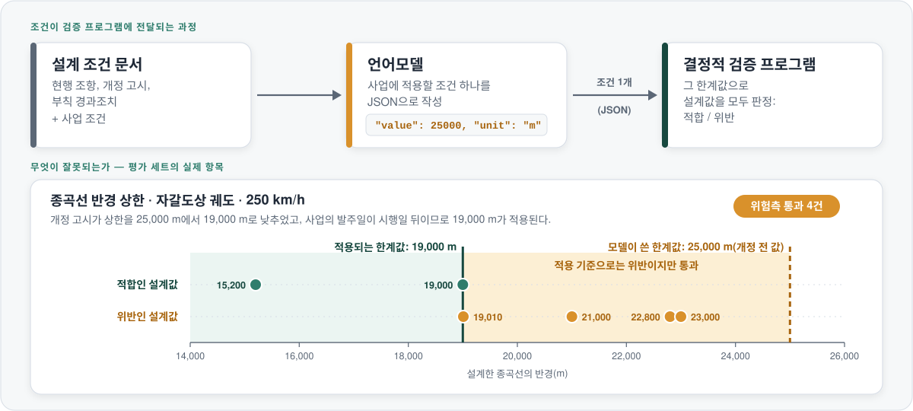

# rail-standard-shift-bench

**철도 설계기준이 개정될 때, 언어모델은 검증 프로그램에 올바른 한계값을 전달하는가?**

사전 등록한 소규모 평가 세트이다. 설계 조건 문서 90개(한국어), 설계값 판정 540건, 공개 언어모델 3종의 기준선, 그리고 GPU 없이 공개 수치를 모두 재현하는 짧은 검증 프로그램으로 구성된다.

[English README](README.md) · [사전 등록 문서](PREREGISTRATION.ko.md) · [한 줄로 재현하기](#수치-재현) · [이용 조건](#이용-조건과-출처)

> **상태: 예비 실험, 2026년 11월.** 실행 전에 고정한 판정 규칙에 따르면 주 결과는 **'판정 불가'**이다. 수치를 인용하기 전에 [이 결과가 보여 주는 것과 보여 주지 않는 것](#이-결과가-보여-주는-것과-보여-주지-않는-것)을 먼저 읽기를 권한다.
>
> **추가 예비 실험 P4(2026-11-26 실행):** 값이 바뀐 기준표, 다른 기준표로 한 소형 모델의 지도학습, 보상 학습 절차의 실행 확인. 자료·채점기·문항별 결과·재현 스크립트는 [`p4/`](p4/README.ko.md)에 있음.



## 왜 이 평가 세트인가

결정적 검증 프로그램은 판정을 매번 다시 계산하므로 판정을 지어내지 않는다. 그러나 주어진 한계값으로만 판정한다. 실무에서 그 한계값은 문서에서 나온다. 기준의 조항, 표의 한 칸을 바꾸는 개정 고시, 어느 사업이 종전 규정을 따르는지를 정한 부칙 경과조치가 그 문서이다.

언어모델이 이런 문서를 읽고 한계값을 잘못 쓰면, 검증 프로그램은 그 값을 그대로 적용하고, 적용 기준으로는 위반인 설계가 '적합'으로 보고된다. 이것을 **위험측 통과**라고 부른다. 이 평가 세트는 위험측 통과가 얼마나 자주, 어떤 문서에서 생기는지를 측정한다.

## 무엇을 측정하는가

| 용어 | 뜻 |
|---|---|
| 조건 | 사업의 칸(규칙, 설계속도, 궤도 종류)에 해당하는 규칙 하나의 한계값 하나. 모델이 JSON 객체 하나로 작성한다 |
| 정답 조건 | 문서에 따라 그 사업에 실제로 적용되는 한계값 |
| 후보 | 판정 대상인 설계값. 항목마다 6개이며 한계값과 그 주변 값, 문서에 값이 둘 나오면 그 사이의 값이다 |
| **위험측 통과** | 정답 조건으로는 위반인데 모델의 조건으로는 적합인 후보(주 지표) |
| 오경보 | 정답 조건으로는 적합인데 모델의 조건으로는 위반인 후보 |
| 보류 | 모델이 답을 유보하였거나 답을 쓸 수 없는 경우(JSON 없음, 알 수 없는 단위, 부등호 방향 오류, 사업과 다른 설계속도·궤도 종류). 그 항목은 설계자에게 넘기며 판정을 내지 않는다 |
| 값 일치 | 모델의 답에서 변환한 한계값이 정답 한계값과 같음 |

## 평가 세트의 구성

**규칙 7개.** 모두 한계값이 하나인 규칙이며 「철도의 건설기준에 관한 규정」(국토교통부 고시)의 조항이다.

| 규칙 | 조건 | 조항 | 적합 조건 | 단위 | 궤도에 따라 다름 | 사업 맥락 | 항목 |
|---|---|---|---|---|---|---:|---:|
| `R-06-01` | 본선 최소 곡선반경 | 제6조제1항 | 값 ≥ 한계값 | m | 예 | 4 | 20 |
| `R-07-01` | 최대 설정캔트 | 제7조제1항 | 값 ≤ 한계값 | mm | 예 | 2 | 10 |
| `R-09-01` | 직선 및 원곡선의 최소 길이 | 제9조 | 값 ≥ 한계값 | m | 아니요 | 2 | 10 |
| `R-10-01` | 본선 최대 기울기 | 제10조제1항 | 값 ≤ 한계값 | ‰ | 아니요 | 2 | 10 |
| `R-11-02` | 최소 종곡선 반경 | 제11조제2항 | 값 ≥ 한계값 | m | 예 | 4 | 20 |
| `R-11-04` | 종곡선 반경 상한 | 제11조제2항 표 ㈜ 단서 | 값 ≤ 한계값 | m | 예 | 2 | 10 |
| `R-11-05` | 종곡선 최소 연장 | 제11조제4항 | 값 ≥ 한계값 | m | 아니요 | 2 | 10 |

**문서 집합 4개, 항목 90개.**

| 집합 | 항목 | 모델에 주는 문서 | 확인하는 것 |
|---|---:|---|---|
| `C` | 18 | 현행 조항 | 올바른 칸의 값을 읽는지 |
| `A_target` | 36 | 조항 + 사업의 칸을 바꾸는 가상 개정 고시(강화 18, 완화 18) | 개정을 적용하는지 |
| `A_neighbour` | 18 | 조항 + 다른 칸을 바꾸는 가상 개정 고시 | 사업과 관계없는 개정에서 값을 그대로 두는지 |
| `T` | 18 | 조항 + 가상 개정 + 가상 부칙 경과조치(발주일이 시행일 전인 사업 10, 후인 사업 8) | 날짜를 비교하여 종전 규정과 개정 규정 중 하나를 고르는지 |

- 사업 맥락은 18개(규칙 × 설계속도 200 또는 250 km/h × 자갈도상 또는 콘크리트도상)이고 맥락마다 항목이 5개이다.
- 항목마다 후보가 6개이므로 항목·후보 쌍은 540개이며, 정답 조건으로 위반이 270개, 적합이 270개이다.
- **실제**: 현행 조항의 문장과 표의 값. **가상**: 개정 고시, 개정 수치, 고시 번호, 부칙 경과조치 전부(문서 안에 '(가상)'으로 표시).

## 항목 하나: 문서에서 판정까지

항목 `P3-T-after-R-11-04-250b`(위 그림의 항목)이다. 모델에 주는 문서는 다음과 같다.

```text
「철도의 건설기준에 관한 규정」 제11조제2항 표 ㈜ 단서: 다만, 종곡선 반경은 1,800미터 이상으로 하여야 하며, 자갈도상 궤도는 25,000미터, 콘크리트도상 궤도는 40,000미터 이하로 하여야 한다.

[개정 고시] 국토교통부고시 제2027-○○○호(가상) 「철도의 건설기준에 관한 규정」 일부개정
제11조제2항 표 ㈜ 단서 중 '자갈도상 궤도는 25,000미터'를 '자갈도상 궤도는 19,000미터'로 한다.
부칙 제1조(시행일) 이 고시는 2027년 3월 1일부터 시행한다.
부칙 제2조(경과조치) 이 고시 시행 당시 기본설계 용역을 발주한 사업에 대해서는 제11조제2항의 개정규정에도 불구하고 종전의 규정에 따른다.

[사업 조건] 설계속도 250킬로미터/시간, 여객화물혼용선, 자갈도상 궤도, 복선 전철 신설 본선, 기본설계 용역 발주일 2027년 4월 2일.
```

현행 조항은 자갈도상 궤도의 종곡선 반경을 25,000 m 이하로 정한다. (가상) 개정 고시는 2027년 3월 1일부터 이 상한을 19,000 m로 낮추고, 시행 당시 기본설계 용역을 이미 발주한 사업만 종전 규정을 따르게 한다. 이 사업의 발주일은 2027년 4월 2일이므로 **19,000 m가 적용된다**.

최선의 프롬프트를 쓴 Qwen3-8B는 종전 값인 **25,000 m**로 답하였다. 그 조건으로 검증 프로그램이 후보 6개를 판정한 결과는 다음과 같다.

| 후보 반경 | 적용되는 한계값(19,000 m)의 판정 | 모델의 한계값(25,000 m)의 판정 | 결과 |
|---:|---|---|---|
| 15,200 m | 적합 | 적합 | 일치 |
| 19,000 m | 적합 | 적합 | 일치 |
| 19,010 m | 위반 | 적합 | **위험측 통과** |
| 21,000 m | 위반 | 적합 | **위험측 통과** |
| 22,800 m | 위반 | 적합 | **위험측 통과** |
| 23,000 m | 위반 | 적합 | **위험측 통과** |

값 하나가 틀리자 위반인 설계 4건이 통과하였다.

## 프롬프트

모든 항목은 다음 형식의 JSON 객체 하나를 요구한다.

```json
{"parameter": "조건 이름", "op": ">= 또는 <=", "value": 0, "unit": "m | mm | ‰",
 "applies": {"design_speed_kmh": 0, "track": "자갈도상 | 콘크리트도상 | 무관"},
 "edition": "현행 | 개정 | 종전", "source": "근거가 된 문장 일부", "abstain": false}
```

| 변형 | 모델에 주는 것 |
|---|---|
| `V0` | 한 줄짜리 시스템 지시와 형식 |
| `V1` | 작성 규칙 7개, 조건 7개의 목록, 시험 집합에 **없는** 조항으로 만든 예시 3개(최선의 프롬프트) |
| `V1SC` | `V1` 프롬프트로 답을 5번 뽑아, 4개 이상이 같은 값으로 변환될 때만 그 값을 쓰고 아니면 보류 |

## 결과

모든 실행은 4비트 양자화(NF4) 모델, thinking 기능 끔, 단일 실행이다. 구간은 규칙 7개를 군집으로 한 부트스트랩(2,000회)의 95% 백분위 구간이다.

| 모델 | 프롬프트 | 위험측 통과(위반 270건 중) | 95% 구간 | 오경보(적합 270건 중) | 보류 항목(90개 중) | 값 일치(90개 중) | 민감도 분석(누락)의 위험측 통과 |
|---|---|---:|---:|---:|---:|---:|---:|
| Qwen3-8B | `V0` | 30 (11.1%) | 5.2%–17.2% | 18 | 10 | 67 | 47 |
| **Qwen3-8B** | **`V1`** | **16 (5.9%)** | **1.2%–13.2%** | 6 | 1 | 83 | 16 |
| Qwen3-8B | `V1SC` | 16 (5.9%) | 1.2%–13.2% | 6 | 1 | 83 | 16 |
| Qwen3-4B-Instruct-2507 | `V0` | 30 (11.1%) | 5.2%–17.2% | 24 | 12 | 64 | 47 |
| Qwen3-4B-Instruct-2507 | `V1` | 16 (5.9%) | 1.9%–9.0% | 20 | 1 | 80 | 16 |
| Qwen3.5-2B | `V0` | 46 (17.0%) | 8.3%–26.8% | 42 | 14 | 51 | 63 |
| Qwen3.5-2B | `V1` | 40 (14.8%) | 7.3%–23.0% | 34 | 10 | 60 | 50 |

마지막 열은 사전 등록한 민감도 분석이다. 쓸 수 없는 답을 보류하지 않고 누락으로 처리한다(`C` 항목은 규칙이 없는 것으로, `A`·`T` 항목은 현행 공식 값으로 판정).

**주 결과(사전에 고정한 규칙으로 선택): Qwen3-8B, `V1`.** 정답 위반 후보 270건 중 16건이 통과하였다(5.9%, 구간 1.2%~13.2%). 적합 후보 270건 중 오경보는 6건, 보류 항목은 90개 중 1개, 값 일치는 90개 중 83개이다. `V1SC`의 수치도 같으므로(일치 문턱 1~5 모두에서 위험측 통과 16건) 둘이 동률이고, 고정한 채점기는 `V1`을 보고한다. 이 경우에 대하여 사전에 고정한 문구는 **'판정 불가(신뢰구간이 5%를 포함)'**이다.

집합별 위험측 통과(위험측 통과 / 정답 위반 쌍):

| 모델·프롬프트 | `C` 현행 조항 | `A_target` 사업의 칸 개정 | `A_neighbour` 다른 칸 개정 | `T` 부칙 경과조치 | 전체 |
|---|---:|---:|---:|---:|---:|
| Qwen3-8B `V0` | 0/54 | 0/108 | 10/54 | 20/54 | 30/270 |
| Qwen3-8B `V1` | 0/54 | 4/108 | 4/54 | 8/54 | 16/270 |
| Qwen3-8B `V1SC` | 0/54 | 4/108 | 4/54 | 8/54 | 16/270 |
| Qwen3-4B-Instruct-2507 `V0` | 0/54 | 0/108 | 10/54 | 20/54 | 30/270 |
| Qwen3-4B-Instruct-2507 `V1` | 0/54 | 0/108 | 0/54 | 16/54 | 16/270 |
| Qwen3.5-2B `V0` | 6/54 | 0/108 | 24/54 | 16/54 | 46/270 |
| Qwen3.5-2B `V1` | 3/54 | 0/108 | 21/54 | 16/54 | 40/270 |

주 결과에서 값이 일치하지 않은 항목 7개:

| 항목 | 적용되는 한계값 | 모델의 한계값 | 위험측 통과 | 오경보 | 모델의 답 |
|---|---:|---:|---:|---:|---|
| `P3-A_neighbour-R-06-01-200s` | 1,600 m | 2,400 m | 0 | 2 | 같은 표의 다른 값을 씀 |
| `P3-T-before-R-11-02-200s` | 14,000 m | 10,500 m | 4 | 0 | 종전 규정이 적용되는데 개정 값을 씀 |
| `P3-A_target-AT-R-11-04-250b` | 19,000 m | 25,000 m | 4 | 0 | 개정 전 값을 그대로 씀 |
| `P3-A_neighbour-R-11-04-250b` | 25,000 m | – | 0 | 0 | 쓸 수 없는 답(궤도 종류), 보류로 처리 |
| `P3-T-after-R-11-04-250b` | 19,000 m | 25,000 m | 4 | 0 | 개정 규정이 적용되는데 종전 값을 씀 |
| `P3-A_neighbour-R-11-05-250b` | 20 m | 26 m | 0 | 4 | 이웃 칸의 새 값을 씀 |
| `P3-A_neighbour-R-11-05-200b` | 20 m | 15 m | 4 | 0 | 이웃 칸의 새 값을 씀 |

## 이 결과가 보여 주는 것과 보여 주지 않는 것

**보여 주는 것**

1. 이 오류 경로는 실제로 있고 셀 수 있다. 주 결과에서 조건 90개 중 4개가 위험한 방향으로 틀렸고, 각각 위반 후보 4건을 통과시켰다(270건 중 16건).
2. 주 결과에서 오류는 기준의 변경과 함께 나타난다. 현행 조항 18개 항목은 값이 모두 일치하였고 위반 후보가 하나도 통과하지 않았다(54건 중 0건). 오류는 모두 개정과 부칙 경과조치 문서에서 나왔다. 가장 작은 모델은 현행 조항에서도 틀렸다(`V1`에서 54건 중 3건).
3. 프롬프트는 오류를 줄였으나 없애지 못하였다. 작성 규칙과 예시(`V0` → `V1`)로 8B와 4B 모델 모두 위험측 통과가 30건에서 16건으로 줄었다. 5회 표본의 다수결은 어느 항목의 결과도 바꾸지 못하였다.
4. 채점 과정이 오류를 더하지 않는다. 정답 조건을 넣으면 변환기와 검증 프로그램이 정답 판정 540건을 모두 재현한다.

**보여 주지 않는 것**

1. **프롬프트만으로 충분한지 여부.** 주 결과의 구간(1.2%~13.2%)이 사전에 고정한 판정 문턱 5%(목표치가 아니라 판정 문턱)를 포함한다. 이 경우의 고정 문구는 '판정 불가'이다.
2. **학습의 효과.** 아무것도 학습하지 않았다.
3. **실제 문서에서의 비율.** 개정문과 부칙은 가상이고, 문서가 짧으며, 항목마다 조건이 하나이다. 실제 과업지시서와 협의 의견은 더 어려울 것으로 예상하나, 이는 예상이며 측정값이 아니다.
4. **일반성.** 국가 기준 하나, 언어 하나, 규칙 7개, 같은 계열의 모델 3종, 4비트 양자화, thinking 기능 끔, 모델·프롬프트마다 단일 실행이다.
5. **안정된 구간.** 부트스트랩의 군집이 규칙 7개뿐이므로 구간이 넓고 불안정할 수 있다.

## 수치 재현

Python 3.9 이상, 표준 라이브러리만 사용하며 노트북에서 몇 초가 걸린다.

```bash
git clone https://github.com/jsmiracle/rail-standard-shift-bench.git
cd rail-standard-shift-bench
python checker/reproduce.py
```

기대 출력:

```text
1. gold verdicts reproduced: 540/540
   round trip (gold condition -> compiler -> checker): exact values 90/90, unsafe passes 0, false alarms 0, holds 0
2. published run, scored again with the minimal checker
   model          var   unsafe pass     95% interval  false alarm   hold  exact  same as published
   qwen35_2b      V0    46/270 (17.0%)  8.3%–26.8%         42/270  14/90     51  yes
   qwen35_2b      V1    40/270 (14.8%)  7.3%–23.0%         34/270  10/90     60  yes
   qwen3_4b_2507  V0    30/270 (11.1%)  5.2%–17.2%         24/270  12/90     64  yes
   qwen3_4b_2507  V1    16/270 (5.9%)   1.9%–9.0%          20/270   1/90     80  yes
   qwen3_8b       V0    30/270 (11.1%)  5.2%–17.2%         18/270  10/90     67  yes
   qwen3_8b       V1    16/270 (5.9%)   1.2%–13.2%          6/270   1/90     83  yes
   qwen3_8b       V1SC  16/270 (5.9%)   1.2%–13.2%          6/270   1/90     83  yes
3. primary claim: {"variant": "V1", "unsafe_pass": 16, "gold_violation_pairs": 270, "ci95": [0.011904761904761904, 0.1322314049586777], "abstain_items": 1, "wording": "판정 불가(신뢰구간이 5%를 포함)"} | same as published: yes
RESULT: REPRODUCED
```

`reproduce.py`는 두 가지를 확인한다. 첫째, 후보 540개를 정답 한계값으로 판정하여 정답 판정과 비교하고, 정답 조건을 모델의 답 형식으로 써서 변환기와 검증 프로그램에 통과시킨다(왕복 확인). 둘째, 공개한 실행 7개 각각에 대하여 `results/scores_p3.json`에 저장된 항목별 상태와 변환된 값을 이 저장소의 검증 프로그램으로 다시 채점하고, 모든 판정·집계·부트스트랩 구간·고정 문구를 저장된 값과 비교한다.

채점 파일 전체를 다시 쓰려면 `python checker/score.py --compiled results/scores_p3.json --out rescored.json`을 실행한다.

`python checker/test_scenarios.py`는 계획을 고정하기 전에 확인한 채점 시나리오(항상 정답 값, 항상 개정 전 값, 다른 궤도 종류, 항상 유보, 5개 중 3개·4개 일치)를 실행하고 `ALL PASS`를 출력한다.

## 다른 모델의 평가

1. `data/items.jsonl`에서 프롬프트를 읽는다(180줄: 항목 90개 × `V0`·`V1`). 줄마다 `item_id`, `variant`, 대화 형식의 `messages`가 있다.
2. 항목마다 한 줄씩 `outputs/raw/<모델 이름>/V1.jsonl`에 쓴다.
   `{"item_id": "P3-C-R-06-01-250b", "output": "<모델이 낸 글>"}`
3. 채점한다. `python checker/score.py --raw outputs/raw --out my_scores.json`

- 파일 이름이 변형이다. `V1SC.jsonl`은 항목마다 `"outputs": [문자열 5개]`를 두며 5개 중 4개 일치 규칙으로 채점한다.
- 채점 파일의 `primary_claim`은 사전 등록에 따라 `qwen3_8b`라는 이름만 본다. 다른 모델은 모델별 출력 줄을 읽는다.
- `data/gold.jsonl`은 정답이므로 프롬프트나 학습 자료에 넣지 않는다.
- 항목과 정답이 공개되어 있으므로 이후 모델의 학습 자료에 들어갈 수 있다. 개정 수치는 가상이므로 새 값으로 바꾸어 다시 시험할 수 있다(항목 생성기는 이번 공개에 포함하지 않았다).

공개한 실행을 같은 모델과 설정으로 반복하려면(CUDA GPU 필요, 공개한 실행은 8 GB 노트북 GPU 사용):

```bash
pip install -r run/requirements.txt        # CUDA 판에 맞는 PyTorch를 먼저 설치
python run/run_models.py --model qwen3_8b  # 그 밖: qwen3_4b_2507, qwen35_2b
python checker/score.py --raw outputs/raw --out my_scores.json
```

모델 리비전과 생성 설정은 `run/config/models.json`에 고정되어 있다. 장비와 라이브러리 판이 다르면 출력 글이 같다고 보장할 수 없다.

## 저장소 구성

```text
checker/railcheck.py      규칙 7개, 변환기(모델의 JSON → 한계값), 판정
checker/score.py          채점기(지표, 군집 부트스트랩, 고정 문구)
checker/reproduce.py      검증 프로그램을 공개 채점 결과와 대조
checker/test_scenarios.py 왕복 확인과 채점 시나리오
data/items.jsonl          프롬프트(정답 없음)
data/gold.jsonl           문서, 정답 조건, 후보, 정답 판정
data/official_values.json 사업 맥락 18개의 현행 한계값(민감도 분석 전용)
data/MANIFEST.json        자료 파일의 SHA-256
results/scores_p3.json    공개 채점 결과: 실행별, 항목별, 후보별
results/env_run.json      공개한 실행의 환경
run/                      공개 모델 3종의 실행기(채점 없음)
PREREGISTRATION.ko.md     사전 등록 문서 원문
PREREGISTRATION.md        사전 등록 문서 영어 번역
docs/                     이 문서의 그림
```

## 자료 형식

`data/gold.jsonl`은 한 줄이 항목 하나이다.

| 필드 | 뜻 |
|---|---|
| `item_id` | 예: `P3-T-after-R-11-04-250b`. 집합, 하위 집합, 규칙, 설계속도, 궤도(`b` 자갈도상, `s` 콘크리트도상) |
| `rule`, `article`, `label` | 규칙 번호, 고시의 조항, 질문에 쓰는 조건 이름 |
| `V`, `track` | 사업 맥락: 설계속도(km/h), `ballast`(자갈도상) 또는 `slab`(콘크리트도상) |
| `cell` | 연구진 엔진의 기준표에서 그 한계값이 놓인 자리 |
| `unit`, `dir` | 한계값의 단위. `min`은 값이 한계값 이상이면 적합, `max`는 이하이면 적합 |
| `set`, `sub` | `C`, `A_target`(`AT` 강화, `AR` 완화), `A_neighbour`, `T`(시행일 `before` 전, `after` 후) |
| `document` | 모델에 주는 문서(질문은 프롬프트에서 덧붙인다) |
| `gold_value` | 사업에 적용되는 한계값 |
| `alt_value` | 문서에 나오는 다른 값: 개정 전 또는 후의 값, 또는 이웃 칸의 새 값(`C`는 `null`) |
| `gold_edition` | `현행`, `개정`, `종전`, `현행(개정 대상 아님)` |
| `true_edits` | 문서가 기준표에 실제로 가하는 변경: `[칸, 값]`의 목록 |
| `candidates` | `{"x": 설계값, "gold": "적합" 또는 "위반"}` 6개 |

`results/scores_p3.json`은 `models → <모델> → <변형>` 아래에 `primary`(건수와 비율), `primary_unsafe_ci95_cluster_rule`, `sensitivity_omission`, `by_set`, `by_set_sub`, `not_ok_reasons`, `items`(항목별 `status`, `reason`, 변환된 `value`, `gold_value`, 후보별 정답 판정과 모델 조건의 판정 `model`, 민감도 분석의 판정 `model_sens`)를 둔다. `V1SC`에는 일치 문턱 1~5의 `sc_curve`가 더 있다. `primary_claim`에는 주 결과와 고정 문구가 있다.

## 사전 등록

모델 출력이 하나도 없을 때 다음을 고정하였다. 항목과 정답 판정, 프롬프트, 채점기, 주 결과를 고르는 규칙, 결과의 경우별 보고 문구이다. [`PREREGISTRATION.ko.md`](PREREGISTRATION.ko.md)(원문)와 [`PREREGISTRATION.md`](PREREGISTRATION.md)(영어 번역)에 있다.

| 단계 | 시각(한국 표준시) |
|---|---|
| 사전 등록 문서, 항목, 정답, 프롬프트, 채점기 커밋 | 2026-11-21 02:18 |
| 모델 실행 | 2026-11-23 20:36~22:23 |
| 채점 | 2026-11-24 |
| 이 공개 | 2026-11-25 |

- `data/items.jsonl`과 `data/gold.jsonl`은 그 커밋의 파일과 바이트 단위로 같다(해시는 `data/MANIFEST.json`, 프롬프트 파일의 해시는 사전 등록 문서에 적혀 있다).
- 이 주장의 한계: 그 커밋은 연구진의 비공개 연구 저장소에 있으므로 이 저장소만으로는 커밋 시각을 확인할 수 없다. 그 이력을 공개할 때 대조할 수 있도록 커밋 해시와 사전 등록 문서의 SHA-256을 적어 두었다.
- `checker/score.py`는 고정한 채점기를 옮긴 것이다. 내용상 달라진 것은 연구진의 검증 엔진을 부르던 자리를 `checker/railcheck.py`의 부등식으로 바꾼 것 하나이며, `reproduce.py`로 결과가 같음을 확인한다.
- 이전 내부 계획과 달라진 점은 실행 전에 적어 두었다(사전 등록 문서 7절). 실행 뒤에 사전 등록에서 벗어난 것은 없다.

## 이 저장소에 없는 것

- **검증 엔진.** 공개한 채점 결과는 연구진의 전체 엔진으로 만들었으며, 엔진은 이번 공개에 포함하지 않았다. 이 평가 세트에서 엔진의 역할은 한계값이 하나인 규칙 7개의 판정이고, 그 판정은 부등식 하나이다. `checker/railcheck.py`가 그 부등식을 구현하며, `reproduce.py`가 정답 540쌍과 공개한 실행의 모든 후보에서 판정이 같음을 확인한다.
- **항목 생성기.** 엔진을 불러 정답 판정을 만들고 검사하기 때문이다.
- **모델의 원 출력.** 채점 파일에는 실행·항목마다 상태, 모델의 답에서 변환한 값, 모든 판정이 들어 있다. 나중에 대조할 수 있도록 원 출력 파일(각 90줄)의 SHA-256을 적는다.

| 실행 | 원 출력 파일의 SHA-256 |
|---|---|
| Qwen3-8B `V0` | `c2c1db54ea8f8268f2be37eb87d6e59a44404e698c09642f61c893d22cd9cc18` |
| Qwen3-8B `V1` | `82bbc9b3b8d8cb95aec9588237155f5f8650761e3859bb53051920bbab574b4e` |
| Qwen3-8B `V1SC` | `0e6ba9ccca08729fd656b4603c3d7d36b41bcbea6a70a954019dffabdfc49500` |
| Qwen3-4B-Instruct-2507 `V0` | `cb459ae425e30ec55c1e88c915633d07a22d7d06ec23470712c42e071c013572` |
| Qwen3-4B-Instruct-2507 `V1` | `b4613215891a2159b424256c70a7c5212354ffaaff06887bb5aae135b669b1d0` |
| Qwen3.5-2B `V0` | `dba8346445e63ffb89ad1b40c2206d5ba8f5a9b1b62e536422a4310c9f327bc8` |
| Qwen3.5-2B `V1` | `9b676cdc666e1cebcdff84feca380dbfe91e8bc6529ca30f503a1b4547700df0` |

- **실제 사업의 문서나 자료.** 이 평가 세트에는 공개된 고시의 문장과 가상 개정문만 있다.

## 공개한 실행의 환경

Windows 11, Python 3.12.10, PyTorch 2.14.1(CUDA 12.6 빌드), transformers 5.22.2, bitsandbytes 0.50.2(NF4, 이중 양자화, bfloat16 계산), NVIDIA GeForce RTX 4070 Laptop GPU(8 GB). 실행 7개 × 항목 90개, 실행 오류 0건. 자세한 내용은 `results/env_run.json`과 `run/config/models.json`에 있다.

## 이용 조건과 출처

- 코드(`checker/`, `run/`): MIT([`LICENSE`](LICENSE)).
- 연구진이 작성한 자료·결과·그림·글: CC BY 4.0([`LICENSE-DATA.md`](LICENSE-DATA.md)).
- 현행 조항의 문장과 표의 값은 연구진의 엔진 프로파일에 등록된 「철도의 건설기준에 관한 규정」(국토교통부고시 제2025-244호, 선형 조문의 내용은 제2022-774호)을 따른다. 고시의 사본에서 옮긴 것이며 관보와는 대조하지 않았다. 표는 글로 풀어 썼고 일부 단서는 생략하였다(문서에 표시).
- **설계에 사용할 수 없다.** 이 자료는 언어모델 평가용이며 기준의 사본이 아니다. 설계 판단에는 반드시 고시 원문을 확인한다.

## 앞으로의 계획

결과가 아니라 계획이다. 실무 문서와 철도 설계 엔지니어의 독립 정답 표기, 규칙의 확대, 한계값이 다른 기준표, 그리고 추가 학습 전후 모델의 같은 지표 비교를 계획하고 있다.

## 인용과 문의

저장소 주소와 사용한 커밋 해시를 함께 인용하기 바란다([`CITATION.cff`](CITATION.cff)). 질문과 오류 제보는 이 저장소의 이슈로 받는다.

코드와 글의 일부는 AI 코딩 도구의 도움을 받아 작성하였다. 이 문서의 수치는 모두 이 저장소의 검증 프로그램이 `results/scores_p3.json`에서 계산한 값이다.
