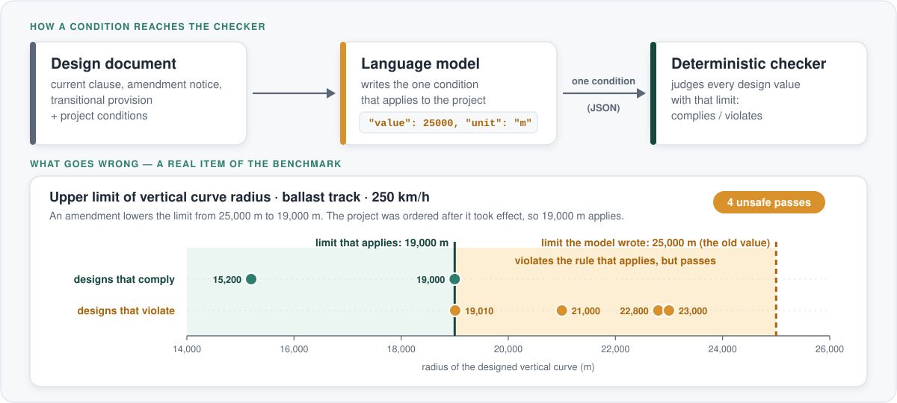

# rail-standard-shift-bench

**When a railway design standard is amended, does a language model hand the rule checker the right limit value?**

A small pre-registered benchmark: 90 design-condition documents (Korean), 540 checks of design values, a baseline for three open language models, and a short checker that reproduces every published number without a GPU.

[한국어 README](README.ko.md) · [Pre-registration](PREREGISTRATION.md) · [Reproduce in one command](#reproduce-the-numbers) · [Licence](#licence-and-sources)

> **Status: pilot study, November 2026.** By the rule fixed before the run, the main result is **inconclusive**. Please read [What the result shows and does not show](#what-the-result-shows-and-does-not-show) before quoting a number.



## Why this benchmark

A deterministic rule checker recomputes every verdict, so it never invents one. But it judges only with the limit values it is given. In practice those values come from documents: a clause of the standard, a notice that amends one cell of a table, a transitional provision that says which projects still follow the former rule.

If a language model reads such a document and writes the wrong limit, the checker applies it faithfully, and a design that violates the applicable rule is reported as compliant. We call this an **unsafe pass**. This benchmark measures how often it happens, and in which kind of document.

## What is measured

| Term | Meaning |
|---|---|
| Condition | One limit value for one rule in the project's cell (rule, design speed, track type). The model writes it as one JSON object |
| Gold condition | The limit value that really applies to the project according to the document |
| Candidate | A design value to be judged. Each item has six, at and around the limit and, where the document names two values, between them |
| **Unsafe pass** | A candidate that violates the gold condition but complies with the model's condition (primary measure) |
| False alarm | A candidate that complies with the gold condition but violates the model's condition |
| Hold | The model abstained, or its answer could not be used (no JSON, unknown unit, wrong direction of the inequality, a design speed or track type that is not the project's). The item goes to the designer and gives no verdict |
| Exact value | The limit compiled from the model's answer equals the gold limit |

The labels in the data files are Korean: `적합` = complies, `위반` = violates, `보류` = hold.

## Contents of the benchmark

**Seven rules**, each a single limit, from the Korean notice 「철도의 건설기준에 관한 규정」 (Rules on Railway Construction Standards; title translated by the authors):

| Rule | Condition | Article | A design value complies if | Unit | Depends on track type | Contexts | Items |
|---|---|---|---|---|---|---:|---:|
| `R-06-01` | Minimum curve radius of main track (본선 최소 곡선반경) | 제6조제1항 | value ≥ limit | m | yes | 4 | 20 |
| `R-07-01` | Maximum applied cant (최대 설정캔트) | 제7조제1항 | value ≤ limit | mm | yes | 2 | 10 |
| `R-09-01` | Minimum length of straight and circular curve (직선 및 원곡선의 최소 길이) | 제9조 | value ≥ limit | m | no | 2 | 10 |
| `R-10-01` | Maximum gradient of main track (본선 최대 기울기) | 제10조제1항 | value ≤ limit | ‰ | no | 2 | 10 |
| `R-11-02` | Minimum vertical curve radius (최소 종곡선 반경) | 제11조제2항 | value ≥ limit | m | yes | 4 | 20 |
| `R-11-04` | Upper limit of vertical curve radius (종곡선 반경 상한) | 제11조제2항 표 ㈜ 단서 | value ≤ limit | m | yes | 2 | 10 |
| `R-11-05` | Minimum vertical curve length (종곡선 최소 연장) | 제11조제4항 | value ≥ limit | m | no | 2 | 10 |

**Four sets of documents**, 90 items:

| Set | Items | Document given to the model | What it tests |
|---|---:|---|---|
| `C` | 18 | The current clause | Reading the right cell |
| `A_target` | 36 | Clause + a synthetic amendment notice that changes the project's cell (18 tighten the limit, 18 relax it) | Applying an amendment |
| `A_neighbour` | 18 | Clause + a synthetic amendment notice that changes another cell | Leaving the value alone when the amendment does not concern the project |
| `T` | 18 | Clause + synthetic amendment + synthetic transitional provision (10 projects ordered before the enforcement date, 8 after) | Comparing dates: former rule or amended rule |

- 18 project contexts (rule × design speed 200 or 250 km/h × ballast or slab track), 5 items per context.
- 6 candidates per item, 540 item–candidate pairs: 270 violate the gold condition and 270 comply.
- **Real**: the sentences and table values of the current clauses. **Synthetic**: every amendment notice, amended value, notice number and transitional provision (marked `(가상)`, "synthetic", inside the documents).

## One item, from document to verdict

Item `P3-T-after-R-11-04-250b` (the one in the figure). The document given to the model:

```text
「철도의 건설기준에 관한 규정」 제11조제2항 표 ㈜ 단서: 다만, 종곡선 반경은 1,800미터 이상으로 하여야 하며, 자갈도상 궤도는 25,000미터, 콘크리트도상 궤도는 40,000미터 이하로 하여야 한다.

[개정 고시] 국토교통부고시 제2027-○○○호(가상) 「철도의 건설기준에 관한 규정」 일부개정
제11조제2항 표 ㈜ 단서 중 '자갈도상 궤도는 25,000미터'를 '자갈도상 궤도는 19,000미터'로 한다.
부칙 제1조(시행일) 이 고시는 2027년 3월 1일부터 시행한다.
부칙 제2조(경과조치) 이 고시 시행 당시 기본설계 용역을 발주한 사업에 대해서는 제11조제2항의 개정규정에도 불구하고 종전의 규정에 따른다.

[사업 조건] 설계속도 250킬로미터/시간, 여객화물혼용선, 자갈도상 궤도, 복선 전철 신설 본선, 기본설계 용역 발주일 2027년 4월 2일.
```

In short: the current rule caps the vertical curve radius on ballast track at 25,000 m. A (synthetic) notice lowers the cap to 19,000 m from 1 March 2027 and keeps the former rule only for projects whose basic-design service was ordered before that date. This project was ordered on 2 April 2027, so **19,000 m applies**.

Qwen3-8B with the best-effort prompt answered **25,000 m**, the former value. The checker then judged the six candidates like this:

| Candidate radius | With the limit that applies (19,000 m) | With the model's limit (25,000 m) | Outcome |
|---:|---|---|---|
| 15,200 m | complies | complies | correct |
| 19,000 m | complies | complies | correct |
| 19,010 m | violates | complies | **unsafe pass** |
| 21,000 m | violates | complies | **unsafe pass** |
| 22,800 m | violates | complies | **unsafe pass** |
| 23,000 m | violates | complies | **unsafe pass** |

One wrong value, four violating designs passed.

## Prompts

Every item asks for one JSON object in this form (the question and the schema are in Korean in the data):

```json
{"parameter": "name of the condition", "op": ">= or <=", "value": 0, "unit": "m | mm | ‰",
 "applies": {"design_speed_kmh": 0, "track": "자갈도상 | 콘크리트도상 | 무관"},
 "edition": "현행 | 개정 | 종전", "source": "part of the sentence used", "abstain": false}
```

| Variant | What the model gets |
|---|---|
| `V0` | A one-line system instruction and the schema |
| `V1` | Seven writing rules, the list of the seven conditions, and three worked examples on clauses that are **not** in the test set (best-effort prompting) |
| `V1SC` | The `V1` prompt sampled five times; the value is used only if at least four samples compile to the same value, otherwise hold |

## Results

All runs: 4-bit quantised models (NF4), thinking mode off, one run each. Intervals are 95% percentile intervals from a bootstrap over the seven rules (2,000 draws).

| Model | Prompt | Unsafe pass (of 270 violating) | 95% interval | False alarm (of 270 complying) | Items on hold (of 90) | Exact value (of 90) | Unsafe pass, omission analysis |
|---|---|---:|---:|---:|---:|---:|---:|
| Qwen3-8B | `V0` | 30 (11.1%) | 5.2%–17.2% | 18 | 10 | 67 | 47 |
| **Qwen3-8B** | **`V1`** | **16 (5.9%)** | **1.2%–13.2%** | 6 | 1 | 83 | 16 |
| Qwen3-8B | `V1SC` | 16 (5.9%) | 1.2%–13.2% | 6 | 1 | 83 | 16 |
| Qwen3-4B-Instruct-2507 | `V0` | 30 (11.1%) | 5.2%–17.2% | 24 | 12 | 64 | 47 |
| Qwen3-4B-Instruct-2507 | `V1` | 16 (5.9%) | 1.9%–9.0% | 20 | 1 | 80 | 16 |
| Qwen3.5-2B | `V0` | 46 (17.0%) | 8.3%–26.8% | 42 | 14 | 51 | 63 |
| Qwen3.5-2B | `V1` | 40 (14.8%) | 7.3%–23.0% | 34 | 10 | 60 | 50 |

The last column is the pre-registered sensitivity analysis: unusable answers are not held but treated as omissions (for `C` items the rule is taken as absent; for `A` and `T` items the current official value is used).

**Primary result (chosen by the rule fixed in advance): Qwen3-8B, `V1`.** 16 of 270 violating candidates passed (5.9%, interval 1.2%–13.2%), with 6 false alarms among 270 complying candidates, 1 of 90 items on hold and 83 of 90 exact values. `V1SC` gave the same numbers (for every agreement threshold from 1 to 5 the unsafe passes stay at 16), so the two tie and the fixed scorer reports `V1`. The wording fixed in advance for this outcome is **"inconclusive (the interval contains 5%)"**, in the original `판정 불가(신뢰구간이 5%를 포함)`.

Unsafe passes by set (unsafe passes / violating pairs):

| Model, prompt | `C` current clause | `A_target` project's cell amended | `A_neighbour` another cell amended | `T` transitional provision | All |
|---|---:|---:|---:|---:|---:|
| Qwen3-8B `V0` | 0/54 | 0/108 | 10/54 | 20/54 | 30/270 |
| Qwen3-8B `V1` | 0/54 | 4/108 | 4/54 | 8/54 | 16/270 |
| Qwen3-8B `V1SC` | 0/54 | 4/108 | 4/54 | 8/54 | 16/270 |
| Qwen3-4B-Instruct-2507 `V0` | 0/54 | 0/108 | 10/54 | 20/54 | 30/270 |
| Qwen3-4B-Instruct-2507 `V1` | 0/54 | 0/108 | 0/54 | 16/54 | 16/270 |
| Qwen3.5-2B `V0` | 6/54 | 0/108 | 24/54 | 16/54 | 46/270 |
| Qwen3.5-2B `V1` | 3/54 | 0/108 | 21/54 | 16/54 | 40/270 |

The seven items where the primary run did not give the exact value:

| Item | Limit that applies | Model's limit | Unsafe passes | False alarms | What the model did |
|---|---:|---:|---:|---:|---|
| `P3-A_neighbour-R-06-01-200s` | 1,600 m | 2,400 m | 0 | 2 | took another value of the same table |
| `P3-T-before-R-11-02-200s` | 14,000 m | 10,500 m | 4 | 0 | took the amended value although the former rule applies |
| `P3-A_target-AT-R-11-04-250b` | 19,000 m | 25,000 m | 4 | 0 | kept the value from before the amendment |
| `P3-A_neighbour-R-11-04-250b` | 25,000 m | – | 0 | 0 | answer not usable (track type), counted as hold |
| `P3-T-after-R-11-04-250b` | 19,000 m | 25,000 m | 4 | 0 | kept the former value although the amended rule applies |
| `P3-A_neighbour-R-11-05-250b` | 20 m | 26 m | 0 | 4 | took the new value of the neighbouring cell |
| `P3-A_neighbour-R-11-05-200b` | 20 m | 15 m | 4 | 0 | took the new value of the neighbouring cell |

## What the result shows and does not show

**It shows**

1. The failure path is real and can be counted. In the primary run 4 of the 90 conditions were wrong in the unsafe direction, and each let 4 violating candidates pass (16 of 270).
2. In the primary run it is tied to change. On the 18 current-clause items every value was exact and no violating candidate passed (0 of 54). All of its errors are on amendment and transitional-provision documents. The smallest model also failed on current clauses (3 of 54 with `V1`).
3. Prompting helped but did not remove it. Rules and examples (`V0` → `V1`) cut unsafe passes from 30 to 16 for both the 8B and the 4B model. Voting over five samples changed the outcome of no item.
4. The scoring chain adds no error of its own. With the gold conditions as input, compiler and checker reproduce all 540 gold verdicts.

**It does not show**

1. **Whether prompting is enough.** The interval of the primary result (1.2%–13.2%) contains 5%, the decision threshold fixed in advance (a threshold, not a target). The fixed wording for this case is "inconclusive".
2. **Any effect of training.** Nothing was trained.
3. **Rates on real documents.** The amendments and transitional provisions are synthetic, the documents are short, and each item holds one condition. The authors expect real task orders and consultation opinions to be harder; that is an expectation, not a measurement.
4. **Generality.** One national standard, one language, seven rules, three models of one family, 4-bit quantisation, thinking mode off, one run per model and prompt.
5. **A stable interval.** The bootstrap has only seven clusters (rules), so the interval is wide and may be unstable.

## Reproduce the numbers

Python 3.9 or later, standard library only, a few seconds on a laptop:

```bash
git clone https://github.com/jsmiracle/rail-standard-shift-bench.git
cd rail-standard-shift-bench
python checker/reproduce.py
```

Expected output:

```text
1. gold verdicts reproduced: 540/540
   round trip (gold condition -> compiler -> checker): exact values 90/90, unsafe passes 0, false alarms 0, holds 0
2. published run, scored again with the minimal checker
   model          var   unsafe pass     95% interval  false alarm   hold  exact  same as published
   qwen35_2b      V0    46/270 (17.0%)  8.3%–26.8%         42/270  14/90     51  yes
   qwen35_2b      V1    40/270 (14.8%)  7.3%–23.0%         34/270  10/90     60  yes
   qwen3_4b_2507  V0    30/270 (11.1%)  5.2%–17.2%         24/270  12/90     64  yes
   qwen3_4b_2507  V1    16/270 (5.9%)   1.9%–9.0%          20/270   1/90     80  yes
   qwen3_8b       V0    30/270 (11.1%)  5.2%–17.2%         18/270  10/90     67  yes
   qwen3_8b       V1    16/270 (5.9%)   1.2%–13.2%          6/270   1/90     83  yes
   qwen3_8b       V1SC  16/270 (5.9%)   1.2%–13.2%          6/270   1/90     83  yes
3. primary claim: {"variant": "V1", "unsafe_pass": 16, "gold_violation_pairs": 270, "ci95": [0.011904761904761904, 0.1322314049586777], "abstain_items": 1, "wording": "판정 불가(신뢰구간이 5%를 포함)"} | same as published: yes
RESULT: REPRODUCED
```

`reproduce.py` does two checks. First, it judges all 540 candidates with the gold limits and compares with the gold verdicts, and it sends every gold condition, written as a model answer, through the compiler and the checker (round trip). Second, for each of the seven published runs it takes the per-item status and compiled value stored in `results/scores_p3.json`, scores them again with this repository's checker, and compares every verdict, every count, the bootstrap interval and the fixed wording with the stored ones.

To write the full score file again: `python checker/score.py --compiled results/scores_p3.json --out rescored.json`.

`python checker/test_scenarios.py` runs the scoring scenarios that were checked before the plan was fixed (always the gold value, always the unamended value, the wrong track type, always abstain, 3-of-5 and 4-of-5 agreement) and prints `ALL PASS`.

## Evaluate your own model

1. Take the prompts from `data/items.jsonl` (180 lines: 90 items × `V0`, `V1`). Each line has `item_id`, `variant` and `messages` in chat format.
2. Write one line per item to `outputs/raw/<your_model_tag>/V1.jsonl`:
   `{"item_id": "P3-C-R-06-01-250b", "output": "<the text your model returned>"}`
3. Score: `python checker/score.py --raw outputs/raw --out my_scores.json`

```python
import json
items = [json.loads(line) for line in open("data/items.jsonl", encoding="utf-8")]
v1 = [it for it in items if it["variant"] == "V1"]      # 90 prompts
# answer = your_model(it["messages"])  ->  {"item_id": it["item_id"], "output": answer}
```

- The file name is the variant. A file named `V1SC.jsonl` must hold `"outputs": [five strings]` per item and is scored with the 4-of-5 rule.
- The `primary_claim` field of the score file follows the pre-registration and looks only at the tag `qwen3_8b`. For other models read the per-model lines.
- Do not put `data/gold.jsonl` into prompts or training data: it holds the answers.
- Items and answers are public, so they can end up in the training data of later models. The amended values are synthetic and can be replaced by new ones for a clean re-test (the item generator is not part of this release).

To repeat the published run with the same models and settings (CUDA GPU, the published run used an 8 GB laptop GPU):

```bash
pip install -r run/requirements.txt        # after installing PyTorch for your CUDA version
python run/run_models.py --model qwen3_8b  # also: qwen3_4b_2507, qwen35_2b
python checker/score.py --raw outputs/raw --out my_scores.json
```

Model revisions and generation settings are pinned in `run/config/models.json`. Identical output text is not guaranteed across hardware and library versions.

## Repository layout

```text
checker/railcheck.py      the seven rules, the compiler (model JSON -> limit value) and the verdict
checker/score.py          the scorer (measures, cluster bootstrap, fixed wording)
checker/reproduce.py      checks the checker against the published scores
checker/test_scenarios.py round-trip gate and scoring scenarios
data/items.jsonl          prompts (no answers)
data/gold.jsonl           documents, gold conditions, candidates and gold verdicts
data/official_values.json current limit values of the 18 contexts (sensitivity analysis only)
data/MANIFEST.json        SHA-256 of the data files
results/scores_p3.json    published scores: per run, per item, per candidate
results/env_run.json      environment of the published run
run/                      runner for the three open models (no scoring inside)
PREREGISTRATION.ko.md     pre-registration, original text
PREREGISTRATION.md        pre-registration, English translation
docs/                     figures of this README
```

## Data format

`data/gold.jsonl`, one item per line:

| Field | Meaning |
|---|---|
| `item_id` | For example `P3-T-after-R-11-04-250b`: set, subset, rule, design speed, track (`b` ballast, `s` slab) |
| `rule`, `article`, `label` | Rule id, article of the notice, Korean name of the condition used in the question |
| `V`, `track` | Project context: design speed in km/h, `ballast` or `slab` |
| `cell` | Address of the limit in the standards table of the authors' engine |
| `unit`, `dir` | Unit of the limit; `min`: a value complies if it is ≥ the limit, `max`: if it is ≤ the limit |
| `set`, `sub` | `C`, `A_target` (`AT` tightened, `AR` relaxed), `A_neighbour`, `T` (`before`, `after` the enforcement date) |
| `document` | The text given to the model (the question is added by the prompt) |
| `gold_value` | The limit that applies to the project |
| `alt_value` | The other value named in the document: the value before or after the amendment, or the new value of the neighbouring cell (`null` for `C`) |
| `gold_edition` | `현행` current, `개정` amended, `종전` former, `현행(개정 대상 아님)` current and not touched by the amendment |
| `true_edits` | Changes of the standards table that the document really makes: list of `[cell, value]` |
| `candidates` | Six `{"x": design value, "gold": "적합" or "위반"}` |

`results/scores_p3.json`: `models → <tag> → <variant>` with `primary` (counts and rates), `primary_unsafe_ci95_cluster_rule`, `sensitivity_omission`, `by_set`, `by_set_sub`, `not_ok_reasons`, and `items` (per item: `status`, `reason`, compiled `value`, `gold_value`, and per candidate the gold verdict, the verdict with the model's condition `model`, and the verdict in the sensitivity analysis `model_sens`). `V1SC` also has `sc_curve` for agreement thresholds 1 to 5. `primary_claim` holds the primary result and the fixed wording.

## Pre-registration

Fixed before any model output existed: the items and gold verdicts, the prompts, the scorer, the rule that chooses the primary result, and the wording for each possible outcome. See [`PREREGISTRATION.md`](PREREGISTRATION.md) (translation) and [`PREREGISTRATION.ko.md`](PREREGISTRATION.ko.md) (original).

| Step | When (KST) |
|---|---|
| Pre-registration, items, gold, prompts and scorer committed | 2026-11-21 02:18 |
| Models run | 2026-11-23 20:36 – 22:23 |
| Scored | 2026-11-24 |
| This public release | 2026-11-25 |

- `data/items.jsonl` and `data/gold.jsonl` are byte-identical to the files of that commit (hashes in `data/MANIFEST.json`; the hash of the prompt file is written in the pre-registration).
- Limits of this claim: the commit is in the authors' private research repository, so its time cannot be checked from this repository. The commit hash and the SHA-256 of the pre-registration file are given so that the claim can be checked if that history is disclosed.
- `checker/score.py` is a port of the fixed scorer. The only change of substance is that the call to the authors' verification engine is replaced by the inequality in `checker/railcheck.py`; `reproduce.py` shows that the results are identical.
- Deviations from the earlier internal plan were written down before the run (section 7 of the pre-registration). There was no deviation from the pre-registration afterwards.

## What is not in this repository

- **The verification engine.** The published scores were produced with the authors' full engine, which is not part of this release. In this benchmark its role is limited to seven single-limit rules, where its verdict is one inequality. `checker/railcheck.py` implements that inequality, and `reproduce.py` confirms the same verdicts for all 540 gold pairs and for every candidate of every published run.
- **The item generator.** It calls the engine to produce and check the gold verdicts.
- **Raw model outputs.** The score file holds, for every item of every run, the status and the value compiled from the model's answer, and all verdicts. SHA-256 of the raw output files (90 lines each), for later checking:

| Run | SHA-256 of the raw output file |
|---|---|
| Qwen3-8B `V0` | `c2c1db54ea8f8268f2be37eb87d6e59a44404e698c09642f61c893d22cd9cc18` |
| Qwen3-8B `V1` | `82bbc9b3b8d8cb95aec9588237155f5f8650761e3859bb53051920bbab574b4e` |
| Qwen3-8B `V1SC` | `0e6ba9ccca08729fd656b4603c3d7d36b41bcbea6a70a954019dffabdfc49500` |
| Qwen3-4B-Instruct-2507 `V0` | `cb459ae425e30ec55c1e88c915633d07a22d7d06ec23470712c42e071c013572` |
| Qwen3-4B-Instruct-2507 `V1` | `b4613215891a2159b424256c70a7c5212354ffaaff06887bb5aae135b669b1d0` |
| Qwen3.5-2B `V0` | `dba8346445e63ffb89ad1b40c2206d5ba8f5a9b1b62e536422a4310c9f327bc8` |
| Qwen3.5-2B `V1` | `9b676cdc666e1cebcdff84feca380dbfe91e8bc6529ca30f503a1b4547700df0` |

- **Real project documents or data.** The benchmark contains only text of a public notice and synthetic amendments.

## Environment of the published run

Windows 11, Python 3.12.10, PyTorch 2.14.1 (CUDA 12.6 build), transformers 5.22.2, bitsandbytes 0.50.2 (NF4, double quantisation, bfloat16 compute), NVIDIA GeForce RTX 4070 Laptop GPU (8 GB). Seven runs × 90 items, no run errors. Details: `results/env_run.json`, `run/config/models.json`.

## Licence and sources

- Code (`checker/`, `run/`): MIT, see [`LICENSE`](LICENSE).
- Data, results, figures and texts written by the authors: CC BY 4.0, see [`LICENSE-DATA.md`](LICENSE-DATA.md).
- The current-clause sentences and table values follow the notice 「철도의 건설기준에 관한 규정」 of the Ministry of Land, Infrastructure and Transport of the Republic of Korea as registered in the authors' engine profile (Notice No. 2025-244; the alignment clauses have the content of Notice No. 2022-774). They were entered from copies of the notice and have not been checked against the official gazette. Tables are written out as plain text and some provisos are left out (marked in the documents).
- **Not for engineering use.** This is evaluation material for language models, not a copy of the standard. Check the official notice before any design decision.

## Planned next steps

These are plans, not results: documents from real practice with answers marked independently by railway design engineers, more rules, standards tables with other limit values, and a comparison of untrained and trained models on the same measure.

## Citing and contact

Please cite the repository URL with the commit hash you used (see [`CITATION.cff`](CITATION.cff)). Questions and error reports: open an issue in this repository.

Parts of the code and texts were prepared with an AI coding assistant. Every number in this README is generated from `results/scores_p3.json` by the checker in this repository.
